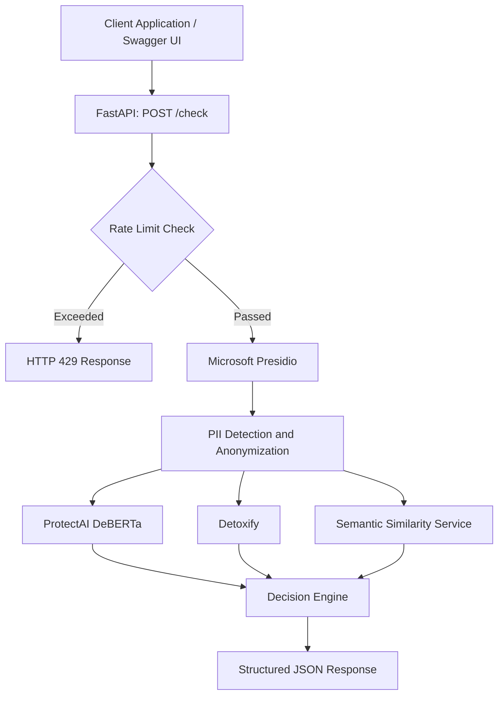

# SemanticShield

### A Multi-Layer AI Input Guardrail API

SemanticShield is a Python-based API designed to inspect user prompts before they are passed to an AI application. It combines rate limiting, personally identifiable information (PII) detection and anonymization, prompt-injection detection, toxicity classification, and semantic similarity checking into a single FastAPI endpoint.

The project explores how different guardrail techniques can work together to improve input security and privacy.

> **Project status:** Active development — prototype. The current implementation uses pretrained models and configurable thresholds. It has not yet been validated as a production-grade security system.

---

## Table of Contents

- [Overview](#overview)
- [Features](#features)
- [Technology Stack](#technology-stack)
- [Architecture](#architecture)
- [Request Processing Flow](#request-processing-flow)
- [Guardrail Components](#guardrail-components)
- [API Reference](#api-reference)
- [Getting Started](#getting-started)
- [Project Structure](#project-structure)
- [Current Limitations](#current-limitations)
- [Future Improvements](#future-improvements)

---

## Overview

AI applications often accept natural-language input directly from users. Those inputs may contain sensitive personal information, malicious instructions, abusive content, or repeated prompts.

SemanticShield provides a centralized API that evaluates incoming prompts using multiple independent checks and returns a structured decision.

Instead of relying on a single model or detection technique, the system combines specialized components:

- **Rate limiting** controls request frequency.
- **Microsoft Presidio** detects and redacts supported PII entities.
- **ProtectAI DeBERTa** classifies potential prompt-injection attempts.
- **Detoxify** scores toxicity-related content.
- **Sentence Transformers** generates sentence embeddings for semantic similarity comparison.

SemanticShield currently focuses on input inspection. It does not execute prompts or send them to a downstream AI model.

## Features

| Feature | Purpose | Implementation |
|---|---|---|
| Request rate limiting | Limits excessive requests from a client IP | Custom in-memory sliding-window rate limiter |
| PII detection | Identifies supported personal information | Microsoft Presidio Analyzer |
| PII anonymization | Replaces detected entities with a common placeholder | Microsoft Presidio Anonymizer |
| Prompt-injection detection | Assigns an injection-classification score | ProtectAI DeBERTa |
| Content moderation | Scores toxicity-related categories | Detoxify |
| Semantic similarity | Compares a prompt with recent prompts belonging to a user ID | Sentence Transformers and cosine similarity |
| REST API | Exposes the checks through HTTP endpoints | FastAPI |
| Interactive API documentation | Allows requests to be tested in a browser | Swagger UI |

## Technology Stack

| Technology | Role in SemanticShield |
|---|---|
| Python 3.11 | Primary programming language |
| FastAPI | API framework and request handling |
| Uvicorn | ASGI server |
| Pydantic | Request-body validation |
| PyTorch | Model inference for supported classifiers |
| Hugging Face Transformers | Loads the prompt-injection classification model |
| ProtectAI DeBERTa | Prompt-injection classification |
| Microsoft Presidio | PII recognition and anonymization |
| spaCy | NLP engine used by the Presidio configuration |
| Detoxify | Toxicity and related content scoring |
| Sentence Transformers | Converts sentences into semantic embeddings |
| MiniLM-L6-v2 | Sentence-embedding model |
| Python collections and threading | In-memory prompt history and rate limiting |

## Architecture

SemanticShield separates API orchestration from individual guardrail implementations. Each guardrail is maintained as a service, while the API route coordinates their execution and combines their results.



**Note:** The injection and toxicity classifiers inspect the original prompt in the current intended request flow. The sanitized prompt is returned to the client and should be used for downstream processing. Semantic similarity should compare and store sanitized prompts to reduce the retention of detected PII.

### Request Processing Flow

1. **Receive and validate:** FastAPI receives a JSON request containing a `user_id` and `prompt`.
2. **Apply rate limiting:** The client's IP address is checked against the configured request limit.
3. **Detect and redact PII:** Presidio identifies supported personal information and replaces detected spans with `<REDACTED>`.
4. **Classify prompt injection:** ProtectAI DeBERTa produces an injection-classification score.
5. **Score content safety:** Detoxify produces scores for toxicity and related categories.
6. **Check semantic similarity:** MiniLM embeddings are compared against the user's recent prompt history using cosine similarity.
7. **Apply the decision policy:** Injection detection, toxicity and semantic similarity can each cause the request to be blocked. PII detection alone does not automatically block the request.
8. **Return the result:** The API returns an `allowed` decision, reasons, the sanitized prompt and the results of each check.

---

## Guardrail Components

### 1. Rate Limiting

**File:** `app/services/rate_limiter.py`

The custom rate limiter uses timestamps stored in deques, with a lock to protect concurrent access.

Current configuration:

- Maximum accepted requests: 5
- Time window: 60 seconds
- Identifier: Client IP address
- Response when exceeded: HTTP `429 Too Many Requests`
- Retry information: `Retry-After` response header

The implementation uses in-memory storage. Rate-limit state resets when the application restarts and is not shared between separate worker processes.

### 2. PII Detection and Anonymization

**File:** `app/services/pii_guardrail.py`

SemanticShield uses two Presidio components:

- `AnalyzerEngine` detects supported PII entities and produces detection results.
- `AnonymizerEngine` uses those results to replace detected text spans.

A shared default replacement operator replaces detected entities with `<REDACTED>`.

Example:

**Input**

```text
My email is alex@example.com and my phone number is 212-555-0123.
```

**Illustrative sanitized output**

```text
My email is <REDACTED> and my phone number is <REDACTED>.
```

The API also returns detected entity types and confidence scores without including the original matched values in its entity list.

Detection is not exhaustive: entities that Presidio fails to recognize will not be redacted.

### 3. Prompt-Injection Detection

**File:** `app/services/prompt_injection.py`

The service uses the pretrained model:

[`protectai/deberta-v3-base-prompt-injection-v2`](https://huggingface.co/protectai/deberta-v3-base-prompt-injection-v2)

The service tokenizes the input, runs inference with PyTorch, applies softmax to the model logits and extracts the injection-class score.

Current configuration:

- Maximum input length: 512 tokens
- Initial detection threshold: `0.50`
- Device: CUDA when available, otherwise CPU
- Model loading: Cached for reuse

The threshold is a starting configuration and has not been calibrated against a representative evaluation dataset. The model can produce false positives and false negatives; a score is not proof that an attack exists.

### 4. Content Safety

**File:** `app/services/toxicity_guardrail.py`

SemanticShield uses the original Detoxify model:

[`Detoxify`](https://github.com/unitaryai/detoxify)

It scores toxicity-related categories, such as:

- Toxicity
- Severe toxicity
- Obscene content
- Threats
- Insults
- Identity attacks

Current configuration:

- Initial toxicity threshold: `0.80`
- Output: Overall toxicity score, category scores and a Boolean detection result

The current policy flags a prompt when its overall toxicity score reaches the configured threshold. Toxicity scores are model outputs, not definitive judgments of intent or context.

### 5. Semantic Similarity

**File:** `app/services/semantic_similarity.py`

SemanticShield uses the Sentence Transformers model:

[`sentence-transformers/all-MiniLM-L6-v2`](https://huggingface.co/sentence-transformers/all-MiniLM-L6-v2)

The service converts the incoming prompt and previous prompts into sentence embeddings. It calculates cosine similarity between the new embedding and the stored prompt embeddings, then identifies the highest-scoring match.

Current configuration:

- Similarity threshold: `0.75`
- History capacity: 10 recent prompts per user ID
- Similarity method: Cosine similarity
- Storage: In-memory history

For example, the following prompts may have a high similarity score despite using different words:

```text
How can I reset my password?
How do I change my password?
```

Semantic similarity does not establish that a prompt is malicious. The current decision policy blocks requests flagged by this check, so repeated but legitimate questions may also be rejected. The threshold requires evaluation and tuning.

---

## API Reference

### Base URL

```text
http://127.0.0.1:8000
```

### `GET /health`

Checks whether the application is responding.

**Example response**

```json
{
  "status": "healthy"
}
```

### `POST /check`

Submits a prompt for guardrail evaluation.

**Request body**

```json
{
  "user_id": "demo-user",
  "prompt": "Explain how binary search works."
}
```

Both fields are required. The API validates `user_id` as a string of 1–100 characters and `prompt` as a string of 1–5,000 characters.

**Response structure**

```json
{
  "allowed": true,
  "reason": [
    "All checks passed"
  ],
  "sanitized_prompt": "Explain how binary search works.",
  "checks": {
    "rate_limit": "passed",
    "pii": {
      "detected": false,
      "entities": [],
      "anonymized_text": "Explain how binary search works."
    },
    "prompt_injection": {
      "detected": false,
      "score": 0.01,
      "threshold": 0.5,
      "model": "protectai/deberta-v3-base-prompt-injection-v2"
    },
    "toxicity": {
      "detected": false,
      "toxicity_score": 0.01,
      "threshold": 0.8,
      "scores": {}
    },
    "semantic_similarity": {
      "similarity_score": 0.0,
      "similar": false,
      "matched_prompt": null
    }
  }
}
```

*The numeric scores above are illustrative, not recorded model results. Actual responses depend on the model predictions and existing prompt history.*

### HTTP Status Codes

| Status | Meaning |
|---|---|
| `200 OK` | The request was evaluated and a decision was returned. A `200` response does not necessarily mean the prompt was allowed. |
| `422 Unprocessable Entity` | The request body failed validation. |
| `429 Too Many Requests` | The client's IP exceeded the configured rate limit. |

### Test Using Swagger UI

1. Start the application.
2. Open [`http://127.0.0.1:8000/docs`](http://127.0.0.1:8000/docs).
3. Expand `POST /check`.
4. Click **Try it out**.
5. Enter a JSON request and click **Execute**.
6. Inspect the response to see which guardrails flagged the prompt.

No separate Python test client is required for manual API testing.

---

## Getting Started

### Prerequisites

- Python 3.11
- Git
- An internet connection for installing dependencies and downloading pretrained models

### 1. Clone the repository

```powershell
git clone https://github.com/Joyslin-2006/SemanticShield.git
cd SemanticShield
```

### 2. Create and activate a virtual environment

On Windows PowerShell:

```powershell
py -3.11 -m venv .venv
.\.venv\Scripts\Activate.ps1
```

### 3. Install dependencies

```powershell
python -m pip install -r requirements.txt
```

Download the English spaCy model used by the Presidio configuration:

```powershell
python -m spacy download en_core_web_lg
```

### 4. Start the application

```powershell
python -m uvicorn app.main:app --reload
```

### 5. Open the API documentation

- Swagger UI: [`http://127.0.0.1:8000/docs`](http://127.0.0.1:8000/docs)
- Health endpoint: [`http://127.0.0.1:8000/health`](http://127.0.0.1:8000/health)

**First startup:** Pretrained model downloads and initialization may take time and require substantial disk space. Hardware and model-library compatibility can affect inference speed.

---

## Project Structure

```text
SemanticShield/
├── app/
│   ├── __init__.py
│   ├── main.py
│   ├── api/
│   │   ├── __init__.py
│   │   └── routes.py
│   └── services/
│       ├── rate_limiter.py
│       ├── pii_guardrail.py
│       ├── prompt_injection.py
│       ├── toxicity_guardrail.py
│       └── semantic_similarity.py
├── requirements.txt
├── .gitignore
└── README.md
```

- `main.py` creates the FastAPI application and registers the API routes.
- `api/routes.py` validates requests, orchestrates the guardrail services, applies the current blocking policy and returns JSON.
- `services/rate_limiter.py` manages request-frequency limits.
- `services/pii_guardrail.py` handles PII detection and anonymization.
- `services/prompt_injection.py` performs injection classification.
- `services/toxicity_guardrail.py` scores content toxicity.
- `services/semantic_similarity.py` compares prompt embeddings.

---

## Current Limitations

SemanticShield is a developing prototype. Important limitations include:

1. **In-memory state:** Rate-limit counters and prompt history are lost on restart and are not shared across application workers.
2. **Client-provided user IDs:** The `user_id` field is not authenticated, so clients can choose different IDs and bypass per-user history checks.
3. **Limited prompt history:** Similarity comparison currently uses only the 10 most recent prompts, rather than a persistent searchable embedding store.
4. **Detection errors:** Pretrained models can make false-positive and false-negative predictions.
5. **Uncalibrated thresholds:** The current injection, toxicity and similarity thresholds are initial settings that require testing on representative data.
6. **No downstream AI integration:** The current API evaluates prompts and returns sanitized output; it does not yet forward prompts to a language model.
7. **No production security claim:** This system should not be treated as a complete defense against prompt injection or other AI security attacks without further validation.

## Future Improvements

- Build automated tests using benign prompts, injection attempts, toxic content and semantically similar examples.
- Evaluate false-positive and false-negative rates for each classifier.
- Tune decision thresholds against a representative dataset.
- Persist prompt history and embeddings, with appropriate retention controls.
- Use authenticated user or session identifiers.
- Introduce shared rate limiting with Redis for multi-worker deployments.
- Add monitoring, structured logging and latency measurements.
- Evaluate alternative prompt-injection classifiers and more robust detection approaches.
- Integrate the sanitized prompt with a downstream AI application.
- Improve redaction validation and security testing before production deployment.

---

## Learning and Engineering Goals

SemanticShield is being developed to explore practical AI input security, model inference, privacy-aware text processing and the architecture of an API that orchestrates multiple independent guardrails.

The project emphasizes clear service boundaries, inspectable decisions, configurable detection thresholds and iterative evaluation rather than assuming that a single model can reliably identify every unsafe input.

## Author

**Joyslin Jenifer M**

GitHub: [@Joyslin-2006](https://github.com/Joyslin-2006)

Repository: [SemanticShield](https://github.com/Joyslin-2006/SemanticShield)
